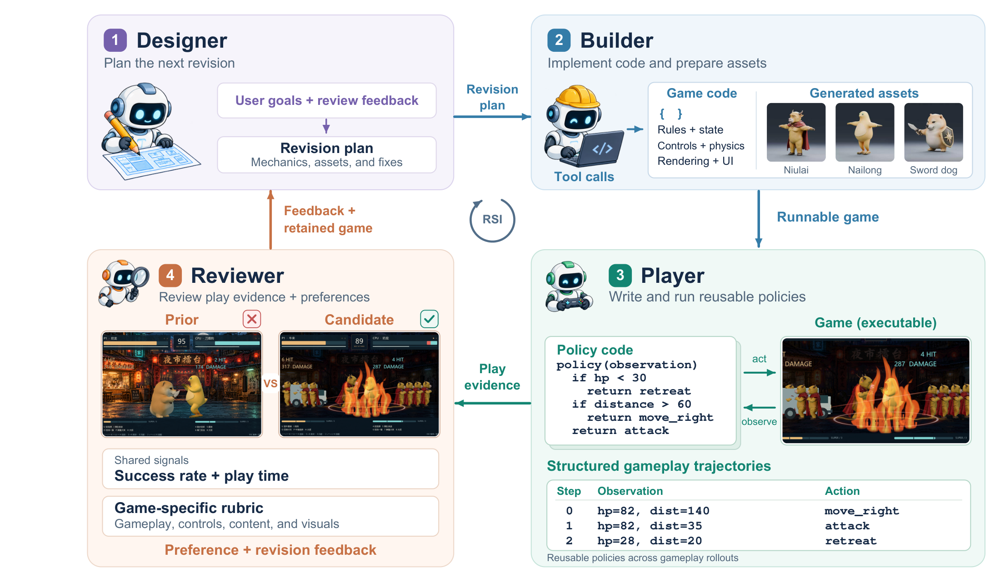

# Recursive Game Creator

<div align="center">

**An Agentic Product-Level Experience-Oriented Game Harness**

[Jiajun Chen](https://imbaldy.github.io/)<sup>1,2,3,†</sup>, [Haoyu Wu](https://cintellifusion.github.io/)<sup>1,2,†</sup>, [Mingda Jia](https://luyitas.github.io/)<sup>1,2,3,†</sup>, [Xihui Liu](https://xh-liu.github.io/)<sup>1,2,3,*</sup>

<sup>1</sup> HKU MMLab &nbsp;&nbsp; <sup>2</sup> The University of Hong Kong &nbsp;&nbsp; <sup>3</sup> Shenzhen Loop Area Institute

<sup>†</sup> Equal contribution &nbsp;&nbsp; <sup>*</sup> Corresponding author

[](https://arxiv.org/abs/2610.08621)
[](https://imbaldy.github.io/recursive-game-creator/)
[](LICENSE)

[Overview](#overview) · [Installation](#installation) · [Quick Start](#quick-start) · [Benchmarks](#benchmarks) · [Citation](#citation)

</div>

## Overview

[](docs/assets/framework-overview.png)

**Recursive Game Creator** is an experience-oriented harness for advancing agentic game development from playable prototypes toward entertaining games. It connects four roles in a recursive development loop: the **Designer** plans revisions, the **Builder** implements candidate games, the coding-native **Player** executes reusable gameplay policies, and the **Reviewer** turns gameplay evidence and user preferences into experience assessments and revision feedback.

**Key features**

- **Recursive game refinement.** Iteratively improve mechanics, content, and presentation through a shared design–build–play–review loop.
- **Coding-native playtesting.** Execute reusable policies through programmatic interfaces to collect diverse gameplay trajectories without per-action model inference.
- **Experience-oriented review.** Combine behavioral trajectories, visual observations, and user preferences with game-specific evaluation criteria.
- **HTML and Godot support.** Develop and test games in isolated runtimes, with optional image, 3D asset, and Blender integration.

Visit the [project page](https://imbaldy.github.io/recursive-game-creator/) for the overview video and examples of games evolving across versions.

## Installation

**Requirements:** macOS or Linux, Git, Node.js 22/npm, and a running local Docker daemon with Compose and Buildx. Python 3.12 and project tools are installed by the setup script. The Docker runtime uses software rendering and does not require a host GPU.

Clone the repository and run the setup script:

```sh
git clone https://github.com/IMBALDY/RecursiveGameCreator.git
cd RecursiveGameCreator
sh scripts/setup.sh
```

This installs the locked Python environment, Harbor, and Codex CLI; builds the game runtime and role images; and checks the environment with an offline smoke test. Tools are kept in `.tools/` and `.venv/`. The first run downloads dependencies and builds the images; subsequent runs reuse cached packages and build layers.

Activate the environment in each new terminal:

```sh
# zsh / bash
source .venv/bin/activate
```

<details>
<summary>fish and alternative installation modes</summary>

```fish
source .venv/bin/activate.fish
```

```sh
# Python dependencies and offline mock test only; no Docker or login required.
sh scripts/setup.sh --minimal

# Install host tools and build the Docker images separately.
sh scripts/setup.sh --skip-images
```

For manual image builds, pinned tool versions, and troubleshooting, see [Environment Setup](docs/setup.md).

</details>

### Authentication

Configure file-backed Codex authentication, then complete the browser login:

```sh
codex login -c 'cli_auth_credentials_store="file"'
codex login status
```

The adapter reads `~/.codex/auth.json`. The example configurations use `gpt-6-astra`; set `model` to one available to your account. Real generation uses your configured model service. See [Environment Setup](docs/setup.md#authentication) for authentication checks.

### Optional asset generation

The quickstart examples run without external asset services. To enable Hunyuan image or 3D generation:

```sh
cp .env.hunyuan.example .env.hunyuan
```

Set `HUNYUAN_API_KEY` in this local file and configure the asset counts in your experiment. Keep credentials outside version control. See [Configuration](docs/configuration.md) for Hunyuan and Blender settings.

## Quick Start

All commands below run from the repository root with the environment activated.

### Generate a game

```sh
game-agent start examples/quickstart-html.json \
  --prompt 'Create a keyboard-controlled arcade game with clear goals, readable feedback, and a restart button.' \
  --run-dir runs/first-html
```

For a Godot game:

```sh
game-agent start examples/quickstart-godot.json \
  --prompt 'Create a small platformer with responsive jumps, readable hazards, and a clear goal.' \
  --run-dir runs/first-godot
```

Each quickstart runs one development round and collects three policy trajectories per tested version. Progress and stage timing are printed to the terminal; games, trajectories, and review records are saved under the selected run directory.

### Run recursive refinement

Copy a quickstart configuration and set `rounds` to `3` for a three-round run:

```sh
cp examples/quickstart-html.json examples/my-game.local.json
# Edit examples/my-game.local.json: set rounds to 3 and update brief.
game-agent start examples/my-game.local.json --run-dir runs/my-game
```

| Setting | Purpose |
| --- | --- |
| `brief` | Game requirements and intended experience; `--prompt` overrides it for a new run |
| `rounds` | Number of development rounds; `3` runs rounds 0, 1, and 2 |
| `source` | Optional starting game project, relative to the configuration file |
| `model` / `reasoning` | Model and reasoning settings for the role agents |
| `player.trajectories_per_version` | Number of policy trajectories collected per tested version |
| `runtime.max_game_instances` | Host-wide limit on concurrent game instances |

The first validated game becomes the retained version. Later candidates replace it only after passing the configured checks and receiving consistent preference in both anonymous A/B presentation orders. The full configuration reference is in [docs/configuration.md](docs/configuration.md).

### Inspect and resume

```sh
game-agent status runs/my-game
game-agent report runs/my-game
game-agent stop runs/my-game
game-agent resume runs/my-game
```

Use a new directory for each `start`. To resume interrupted work, wait for the previous controller to stop, then use `resume`; completed stages and comparison records are reused.

### Export and play

Export the retained game's source and assets:

```sh
game-agent export-game runs/first-html --output exports/first-html
python -m http.server 8080 --directory exports/first-html/game
```

Open [localhost:8080](http://localhost:8080/) to play. For a Godot export, open `game/project.godot` with a matching Godot installation. Each export includes a manifest identifying the selected version and its files. Exports contain source projects; platform-specific executables can be built separately.

## Benchmarks

The [paper](https://arxiv.org/abs/2610.08621) reports the following results:

| Benchmark | Metric | Result |
| --- | --- | ---: |
| GameCraft-Bench | Overall score after three refinement rounds | **77.89** |
| GameASG-Bench | Strict task success rate | **53.2%** |
| GameASG-Bench | Mean runtime-check pass rate | **93.4%** |

The strict task success rate on GameASG-Bench improves by **34.1 percentage points over the same-model baseline**. See the paper for the full protocols and comparisons, and [Benchmark Setup](docs/benchmarks.md) for the evaluation adapters, pinned benchmark revisions, and required dependencies.

## Documentation

| Guide | Contents |
| --- | --- |
| [Environment Setup](docs/setup.md) | Installation options, tool versions, Docker images, and troubleshooting |
| [Configuration](docs/configuration.md) | Role settings, asset services, paths, and recovery |
| [Architecture](docs/architecture.md) | Four-role workflow and version selection |
| [Coding-Native Player](docs/player-policy.md) | Policy interfaces, trajectories, and execution |
| [Benchmarks](docs/benchmarks.md) | GameCraft-Bench and GameASG-Bench setup |
| [Performance and Storage](docs/performance.md) | Scheduling, artifact retention, and efficiency changes |
| [Testing](docs/testing.md) | Offline checks, integration tests, and package builds |

```text
src/game_agent_lite/   Controller, role prompts, and engine interfaces
scripts/              Environment setup and benchmark runners
examples/             HTML, Godot, and offline configurations
docker/               Isolated role and game runtime images
docs/                 Detailed guides and framework figure
tests/                Offline regression and runtime integration tests
runs/                 Generated games, trajectories, and review records
```

### Development

Run the offline regression suite and build the package:

```sh
.venv/bin/pytest
.venv/bin/uv build
```

Runtime integration checks are opt-in; instructions are listed in [Testing](docs/testing.md). Contribution guidelines are in [CONTRIBUTING.md](CONTRIBUTING.md).

## Citation

If you use Recursive Game Creator in your research, please cite:

```bibtex
@misc{chen2026recursivegamecreatoragentic,
  title={Recursive Game Creator: An Agentic Product-Level Experience-Oriented Game Harness},
  author={Jiajun Chen and Haoyu Wu and Mingda Jia and Xihui Liu},
  year={2026},
  eprint={2610.08621},
  archivePrefix={arXiv},
  primaryClass={cs.AI},
  url={https://arxiv.org/abs/2610.08621}
}
```

## License

The source code is released under the [MIT License](LICENSE). Paper figures, game screenshots, and other non-code assets are outside this code license unless separately stated; see [figure attribution](docs/assets/README.md). Third-party code, tools, and benchmarks retain their respective licenses.
