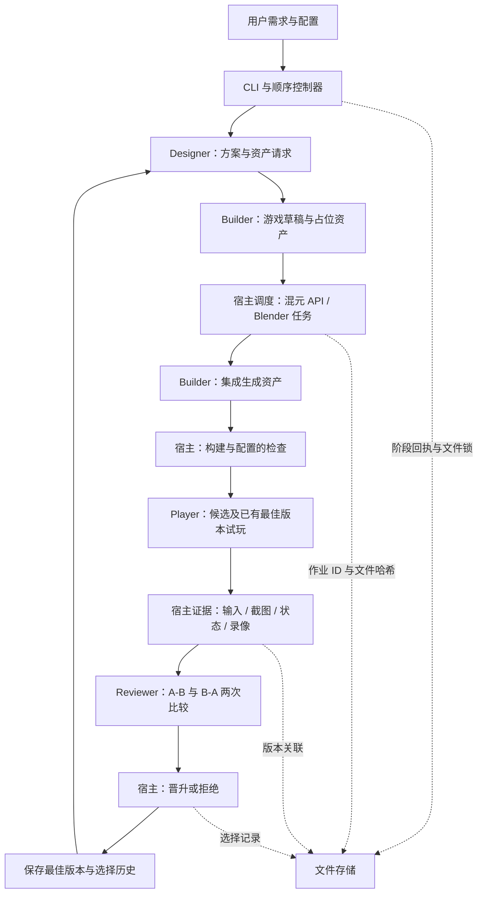
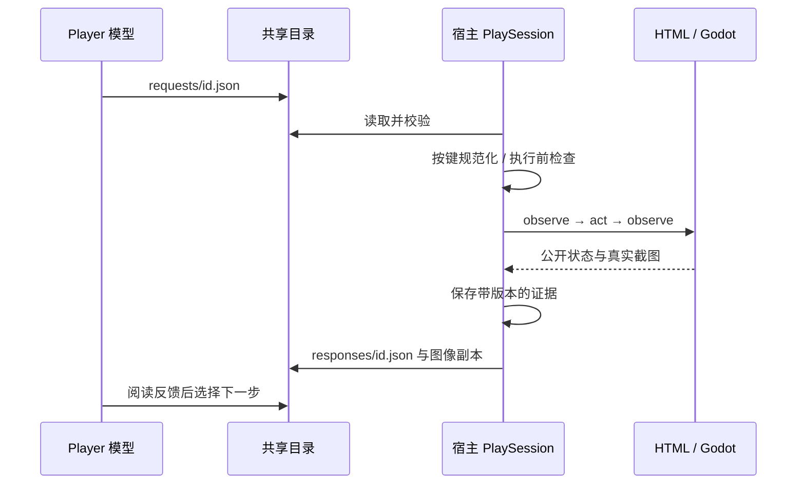

# 架构与引擎协议

本文描述 Recursive Game Creator 当前实现；安装入口见 [README](../README.md)，效率改动与保留的评估规则见 [performance.md](performance.md)。

## 1. 一分钟理解

这是一个**使用现成模型，持续生成、试玩、比较和改进游戏的顺序控制器**。用户提供需求后，系统设计游戏，编写代码，按需生成资产，在真实引擎中试玩，再决定是否保留候选版本。

最需要记住的五件事：

1. **进化对象是游戏项目**：代码、规则、内容、资产及其集成。模型权重、角色提示词和控制器代码不会在正常 rollout 中自动进化。
2. **四个角色是四种调用职责**：Designer、Builder、Player、Reviewer。目前默认使用同一个 Codex 模型，不是四个专门训练的模型，也不是四个持续并行运行的进程。
3. **Harbor 管角色执行，宿主机管游戏和生成服务**：本地 Python 调度引擎、资产与录像；`runtime.mode: docker` 将 HTML/Godot、Blender 和媒体任务放入统一运行镜像，混元 API 仍由宿主调用。
4. **真实输入和图像反馈进入证据记录**：Player 读取源码后生成/适配 Policy，Godot 在游戏进程内执行 `.gd`，HTML 由隔离 Python 工作进程决策，框架施加输入并录制。运行时主要读状态，模型事后回看画面；不是纯像素输入的通用玩家。
5. **“晋升”是模型偏好的筛选结果**：代码检查、证据校验和两次交换顺序的比较全部满足条件后，更新最佳版本指针。这还不能证明真人觉得更好玩。

当前定位可写成：**training-free、artifact-level game evolution with engine-grounded playtesting**。这里的 training-free 仅表示本框架不训练或微调模型；artifact-level 表示迭代的是游戏产物。

## 2. Motivation：要解决什么问题

研究目标是让游戏从“能够运行”逐步走向“值得继续玩”。可讨论的质量维度包括有意义的选择、策略组合、挑战节奏、反馈清晰度、视听一致性和重玩意愿。

本项目的研究假设是：**将设计假设、代码修改、生成资产、真实试玩和版本比较放进同一个闭环，可能比只修复运行错误或只修改数值更有效地改善游戏体验。** 这是待验证的假设，不是已有结论。

资产在这个假设中的作用需要具体化。例如，敌人轮廓更清楚可能帮助玩家判断威胁，赛道地标可能帮助路线辨识，灯具可动部件可能增强资源消耗反馈。图片更精细、模型更多、代码改动更大，本身都不能证明乐趣增加。

当前代码支持 Designer 提出规则、内容和美术变化，但没有强制将“玩法进化”“资产进化”“视觉改善”分别测量。因此，论文需要验证实际修改了什么，以及这些修改为何影响玩家体验。

## 3. 总体架构



阶段顺序固定为：`design → draft → assets → integrate → check → play → review → select`。

单个实验的阶段顺序执行，每轮只有一个候选；当前没有种群、并行候选搜索或跨实验调度器。
policy Player 在同一版本内默认串行运行三条轨迹，由 `player.parallel_episodes` 配置；
各自使用独立引擎、策略实例和证据目录；Godot 策略与自己的游戏共用进程。Godot 同时隔离项目副本与用户存档，汇总后才进入分析。
candidate 与 incumbent 仍顺序评测。不同实验和并行游戏实例会共享本机 CPU/GPU 资源。

普通 Player 不限 20 秒。GameCraft 的独立 `prepare-gamecraft` 入口复用已保存的 Godot
策略补录最多 20 秒的演示，再导出官方输入 JSON；官方重放和评分仍另行执行。
详见 [Player 接口](player-policy.md)和 [演示准备](gamecraft-export.md)。

实现使用 Python ≥3.12、JSON Schema 校验和 Playwright；文件存储、HTTP、子进程与线程主要使用 Python 标准库。没有数据库或消息队列。Godot、Blender、FFmpeg、Harbor 和 Codex CLI 是外部运行依赖，角色容器使用预装 Codex；默认配置要求的 Codex CLI 版本为 0.153.4。安装依赖和包入口见 [pyproject.toml](<../pyproject.toml>)。

### 执行位置

| 位置 | 承担的工作 |
|---|---|
| 宿主 Python | 控制循环、存储、版本校验、资产 API、引擎操作、录像、停止与恢复 |
| Harbor / Docker | 运行各角色的 Codex 调用，挂载角色共享目录；Builder 另外获得候选项目目录 |
| 本地 Codex 后端 | 可选执行后端，通过本机 Codex CLI 完成相同角色调用 |
| 宿主 Grok 后端 | 可选执行后端，通过本机 `grok` 完成相同角色调用，不进入 Harbor 镜像 |
| Mock 后端 | 离线验证流程与协议；不产生真实模型能力或游戏质量证据 |
| HTML / Godot | 运行游戏，接收真实输入，提供图像和公开状态；HTML/Godot 可选统一运行容器 |
| 混元 / Blender | 分别提供生成式图片、3D 资产和 Blender 脚本建模（可在容器执行） |

Harbor 的角色 verifier 检查输出文件是否为可解析 JSON，宿主进一步进行角色 JSON Schema 校验。**Harbor reward=1 表示角色输出通过该层检查，不是游戏乐趣得分。**

## 4. 代码导航

| 文件 | 主要职责与阅读重点 |
|---|---|
| [cli.py](<../src/game_agent_lite/cli.py>) | `start/resume/status/stop/report`；配置合并、相对路径解析、`--prompt` 覆盖 brief |
| [loop.py](<../src/game_agent_lite/loop.py>) | 八阶段循环、角色上下文、候选分支、试玩回执、匿名比较、`promotion()` |
| [agent.py](<../src/game_agent_lite/agent.py>) | Harbor、本地 Codex、Mock；子进程、角色输出、容器标签清理 |
| [game.py](<../src/game_agent_lite/game.py>) | HTML/Godot 适配、`PlaySession`、按键规范化、截图录像、`valid_play()` |
| [runtime.py](<../src/game_agent_lite/runtime.py>) / [runtime_worker.py](<../src/game_agent_lite/runtime_worker.py>) | 可选 Godot 容器后端；环境身份、标准输入输出传输、Xvfb、停止与清理 |
| [assets.py](<../src/game_agent_lite/assets.py>) | TokenHub 请求、下载、3D 查询、Blender 执行、作业恢复与核对 |
| [store.py](<../src/game_agent_lite/store.py>) | 原子 JSON、文件锁、日志、快照、内容哈希、路径约束、脱敏 |
| [types.py](<../src/game_agent_lite/types.py>) | JSON Schema、默认配置、阶段定义；判断字段到底是否已实现的入口 |

建议按 `types.py → loop.py → game.py → assets.py → agent.py → store.py → cli.py` 阅读。需要了解模型行为时，再读四个角色提示词。

其他入口：[提示词目录](<../src/game_agent_lite/prompts>)、[引擎桥接目录](<../src/game_agent_lite/bridges>)、[Harbor 预装 Codex 适配器](<../src/game_agent_lite/harbor_support/preinstalled_codex.py>)、[测试目录](<../tests>)。

## 5. 每轮究竟做了什么

| 阶段 | 实际输入与行为 | 保存结果 |
|---|---|---|
| design | brief、引擎、资产能力与限制、最佳版本的试玩摘要、最近五条选择记录及其详细试玩/评审反馈；调用 Designer | `design.json`：假设、修改、验收描述、资产请求；调用目录保存 `io/evolution_feedback.json` |
| draft | 从当前最佳项目复制候选；没有最佳版本则从 source/seed 或空项目起步；调用 Builder | 独立草稿项目、`draft-builder.json`、`draft.json` |
| assets | 执行方案中的请求，先图片，再混元 3D，再 Blender | 作业回执、资产文件、`assets.json` |
| integrate | 复制草稿，将产物放入 `assets/generated`；再次调用 Builder 接入实际文件 | 独立集成项目、`integrate-builder.json`、`integrate.json` |
| check | 执行配置的构建命令；Godot 进行 headless editor import 并扫描错误；执行可选检查命令 | `check.json`、构建日志、构建后版本哈希 |
| play | 检查通过后，先试玩候选；若已有最佳版本，再独立试玩最佳版本 | 每次试玩的输入、图片、视频、摘要；完成回执和 `play.json` |
| review | 证据有效、已有最佳版本且内容不同，才调用两次 Reviewer | `comparison-0.json`、`comparison-1.json`、`review.json` |
| select | 宿主按固定规则选择，不由 Builder 自报成功决定 | `select.json`、历史记录、必要时更新 `state.best` |

`check` 通过的范围是构建和显式配置的检查。默认 HTML 主要检查入口文件；Godot 能导入项目也不等于所有玩法、碰撞、胜负逻辑已经验证。Designer 的 `acceptance` 是文字验收描述，目前没有通用机制把每条描述自动转成独立的可执行测试。

失败不全是同一种行为：构建检查失败通常使候选被拒绝并进入下一轮；模型调用、资产服务、通信等异常可能使实验停在 `failed` 或 `needs_reconciliation`，等待人工处理和 `resume`。

## 6. 四个角色看到了什么

| 角色 | 上下文与输出 | 当前边界 |
|---|---|---|
| Designer | 输出 `hypothesis/changes/acceptance/assets` | 可设计美术、剧情、玩法，但没有强制单独输出完整 GDD、美术圣经或剧情文档 |
| Builder | 读取方案，在项目目录编写代码；草稿阶段准备占位与 Blender 脚本，集成阶段读取生成结果 | 摘要不是验收证明；候选不能自行修改宿主证据和晋升规则 |
| Player | 初始截图、公开状态、引擎输入能力；通过请求文件操作游戏；输出 `experience/problems/suggestions` | Harbor 模式不挂载游戏源码；本地 Codex 仅依靠工作目录、sandbox 和角色指令，不是严格读取隔离，也不是实时控制器 |
| Reviewer | 仅获得 A/B 的试玩摘要、实际输入、前后截图和录像包；输出 `winner/reason/evidence` | 运行环境可能不能直接观看视频；此时应说明限制并依据能读取的证据判断 |

提示词：[Designer](<../src/game_agent_lite/prompts/designer.md>)、[Builder](<../src/game_agent_lite/prompts/builder.md>)、[Player](<../src/game_agent_lite/prompts/player.md>)、[Reviewer](<../src/game_agent_lite/prompts/reviewer.md>)。

### 当前记忆机制

每次角色调用使用新任务目录。持续性来自外部文件，而非假定模型记住上次调用。

- 后续 Builder 的起点是当前最佳项目，因此继承已保留的代码和资产。
- Designer 得到最佳版本指针所关联的试玩摘要、`history[-5:]`，以及主循环整理的 `evolution_feedback`。
- `evolution_feedback` 展开最近五个已完成轮次的设计、检查、资产清单、双方 Player 总结和两次 Reviewer 原始评语。被拒候选的具体问题也进入下一轮；不额外调用模型做摘要。
- 反馈包含当前最佳版本、各轮候选/对照版本和每次评审的 A/B 映射，保留两次评审分歧。有效截图、录像和输入反馈复制到 Designer 共享目录的 `io/feedback/<round>/<candidate|incumbent>/`，原引用通过 `evidence_files` 映射；缺失或版本不匹配的证据明确标记不可用。历史文件校验通过不能证明评语本身正确。
- `best_experience` 仍来自最佳指针原有的试玩报告；近期对照试玩的更新观察通过 `evolution_feedback.rounds[*].plays.incumbent.summary` 提供，不覆盖原始证据。
- 反馈在每次新设计调用前从已完成回执重建，并保存于调用目录的 `io/evolution_feedback.json`；恢复不重复执行已完成评审，旧实验不需要迁移。
- 没有跨游戏知识库、自动技能学习、向量记忆或通用经验蒸馏。

角色提示词覆盖玩法、美术、资产修复及物理与规则一致性。Reviewer 在 `reason` 字段中提出带证据的建议，Designer 决定如何落实到 `changes/acceptance/assets`。

论文若讨论“持续学习”或“记忆”，应准确描述为这些外部状态和产物的保留，而不是参数学习。

## 7. Player 如何实际操作游戏

统一接口为 `build/start/reset/observe/act/stop`。Player 不直接发游戏引擎命令，而是原子写入角色共享目录的请求文件，宿主轮询并执行，再写回响应。



请求示例（说明协议，不会因为出现在文档里而执行）：

```json
{
  "id": "move1",
  "method": "act",
  "action": {
    "keys": ["Digit1"],
    "duration_ms": 100,
    "pointer": null
  }
}
```

Godot 宿主侧会转换为按键 `1`。`KeyW` 转换为 `w`；重复指向同一个物理按键的别名会合并。未知名称在任何键鼠输入前拒绝，返回 `recoverable: true`、`executed: false` 和输入能力说明，Player 可用新 id 纠正。该恢复机制针对宿主预检查发现的不支持按键；不表示所有格式错误、引擎错误或通信超时都会自动恢复。

成功步骤保存 `requested_action` 与实际 `action`，响应提供 `executed_action`。拒绝记录保存在宿主 `rejected-inputs.json`，不计为成功操作。重复请求 id 不会再次执行。

### HTML 与 Godot 的差别

| 项目 | HTML | Godot |
|---|---|---|
| 输入 | Playwright 键盘、鼠标事件 | TCP 请求进入 Autoload 桥接，再调用 `Input.parse_input_event` |
| 公开状态 | 游戏注册的 `GameAgentBridge.observe()` | `game_agent_target` 节点的 `agent_observe()` |
| reset | 游戏注册的 reset(seed) | 游戏实现的 `agent_reset(seed)` |
| 图像 | 960×540 浏览器截图，保持原输入坐标 | 等待 `frame_post_draw` 后读取完整 viewport，在 PNG 编码前缩放为 640×360 |
| 录像 | 原生录制 640×360，关闭后 FFmpeg 转成 2 FPS MP4；Playwright 内部仍使用默认采样频率 | 目标 2 FPS 采样、640×360；按真实时间间隔输出 2 FPS MP4，缺帧保留画面停留，无音轨 |
| 试玩环境 | headless 可配置 | 当前必须有渲染窗口；配置中的 headless 不把 Godot 试玩变成无窗口渲染 |

普通试玩的最终录像格式为 640×360、2 FPS；这不是游戏渲染或物理频率上限。
Godot 缩放覆盖周期采样和每次操作观察，窗口放大不会导致保存 5K PNG。仍采用主线程 PNG
编码，尚未实现后台编码。实际采样可能低于目标频率，真实间隔不会被快放成连续运动。
HTML 标记 `real_time_resampled_2fps`，Godot 标记 `real_time_sampled_2fps`；
旧报告保留旧模式，不重新标记历史证据。

旧 Godot 快照的桥接与当前宿主版本不同，试玩时会创建独立 `engine/runtime-*/project/`
副本，替换副本的桥接并导入资源。原项目和证据哈希不改写；`video.capture` 保存采集参数及
实际桥接哈希。该副本是宿主采集适配，不参与最佳版本选择，也不是新的游戏候选。
已在使用当前桥接的项目无需复制。更改参数需要新启动或以新进程恢复试玩，不能热更新已有进程。

“公开状态”由生成游戏实现。提示词要求只提供玩家可见信息，但当前没有自动审计证明其中完全不含隐藏信息。论文中应明确观察模式为**截图＋公开结构化状态**，并把纯截图模式列为可选消融，而非宣称当前已是纯视觉玩家。

每次输入保持 16–2000ms 后释放，最多八个键。LLM 推理和工具交互期间游戏通常继续运行；固定种子也不保证两次试玩具有相同轨迹。因此动作游戏还需要更快的局部控制、明确的时间语义或技能执行层，目前尚未实现这些能力。

## 8. 混元和 Blender 的调用机制

生成入口是 Designer 输出中的 `assets` 数组。宿主在 `assets` 阶段处理，Builder 不自行读取混元密钥或提交作业。

每个请求必须包含 `id/kind/prompt/source`。例如：

```json
[
  {"id": "guardian_art", "kind": "image", "prompt": "青铜守卫角色插画，轮廓清楚，统一冷暖配色，无文字", "source": null},
  {"id": "guardian_mesh", "kind": "model", "prompt": "", "source": "guardian_art"},
  {"id": "battle_table", "kind": "blender", "prompt": "制作分离灯座的战斗台", "source": "scripts/build_table.py"}
]
```

| 能力 | 当前封装的输入输出 | 重要边界 |
|---|---|---|
| 混元图片 | 默认 `hy-image-v3`；文字 → 1024×1024 PNG/JPEG | 未接图生图/局部编辑；透明、无缝纹理等属性不能只凭 prompt 假定实现 |
| 混元文生 3D | 默认 `hy-3d-3.1`；文字 → GLB | 请求 PBR；默认 face_count 为 30000，碰撞、骨骼、可动部件和动画要另外处理 |
| 混元图生 3D | 同轮图片 id 或草稿图片路径 → GLB | 参考图最多 6 MiB；当前实现发送图片，不同时发送文字条件 |
| Blender | 草稿中的 Python 脚本 → GLB | 宿主以后台模式执行脚本，通过 `--output` 提供输出路径 |

宿主 API 适配使用 TokenHub 的图片生成、3D submit/query 接口。认证文件由 `assets.env_file` 指定，在真正需要调用时读取；不将密钥写入候选项目。公共清单保存 id、kind、model 和产物哈希；进行中的私有作业回执可能包含下载 URL。

### 当前有与没有的能力

- 已有：图片先生成，再作为同轮 3D 请求的输入；各轮产物与候选项目关联；已完成的同一作业恢复时校验并复用。
- 已有：Builder 可以复用最佳版本中的资产，或在新候选中修改资产集成方式。
- 尚未完整接入：把同轮新生成的混元 GLB 自动作为 Blender 后处理任务的输入。当前 Blender 的 `source` 是**脚本路径**，没有专门的输入模型字段；生成文件在资产阶段全部完成后才复制进集成项目。
- 尚未实现：资产编辑版本图、自动重拓扑/绑定流水线、图像编辑服务、视频/世界/语音生成。

所以“GLB 可被 Blender 编辑”是工具能力；“本框架已实现生成→自动后处理→反馈编辑的完整资产进化链”目前不能作为事实写进论文。

`assets=[]` 表示本轮无需新生成，不代表本游戏从未使用混元。草稿中的 SVG 可能只是生成前占位；应结合资产作业回执、集成代码和实际画面判断是否使用了生成结果。

### 防止重复提交

3D 作业取得 ID 后持久化，恢复时查询原作业。图片结果也保存下载阶段状态。若提交响应不明确，记录为不确定状态并停止核对，使用 `--resolve-job` 或 `--resolve-file` 关联已确认结果；不盲目再次提交。该机制不等于服务端提供了端到端 exactly-once 保证，也不是跨实验资产缓存。

## 9. 最佳版本如何选择

设本轮候选为 C，已有最佳为 B。首次出现有效游戏时建立基线；后续晋升条件为：

```text
promote(C) =
    构建及配置的检查通过
    AND 必需的试玩证据有效且版本匹配
    AND C 与 B 内容不同
    AND 两次比较均偏好 C
    AND 两次比较的引用及证据包检查通过
```

比较顺序固定为：第一次标签 A 对应已有最佳，标签 B 对应候选；第二次标签 A 对应候选，标签 B 对应已有最佳。只有两次都选中候选才晋升。平局、无法判断、偏好已有最佳或两次不一致，都会保留原最佳；候选文件仍保留。

证据有效要求包括：至少一个成功输入步骤、输入前后图片、录像、试玩摘要，以及文件哈希和版本匹配。Reviewer 需要引用两侧存在的证据路径；宿主还检查比较包未被改写。这些检查不验证评语的每个事实，也不能证明模型实际理解了所有图片或视频。

交换顺序可用于考察位置偏好，但两次调用不是两个独立人类评委。匿名标签也不保证摘要或画面完全隐藏版本线索。当前没有数值化总奖励、Elo 排名或人类偏好校准。

下一轮始终从保留下来的最佳项目分支；被拒候选不会自动成为新起点。这是一种每轮单候选、保守接受的搜索流程。

## 10. 保存、版本和恢复

每次实验单独保存在项目的 runs 目录中；下面是布局示意，尖括号表示变量：

```text
runs/<run>/
├── config.json                   # 创建时解析后的配置及 brief
├── state.json                    # round、phase、status、best、history、error
├── events.jsonl                  # 阶段和状态事件
├── run.lock                      # OS 文件锁；文件存在本身不表示进程仍活着
├── report.md                     # CLI 执行到报告步骤后生成
├── seed/                         # 可选已有项目起点
└── rounds/0000/
    ├── design.json / draft.json / assets.json / integrate.json
    ├── check.json / play.json / review.json / select.json
    ├── draft-<id>/project/
    ├── integrate-<id>/project/    # 本轮集成后的游戏项目
    ├── assets/<asset-id>/        # 生成文件与 job.json
    ├── played-candidate.json     # 完成的候选试玩回执
    ├── played-incumbent.json     # 完成的最佳版本对照试玩回执
    ├── comparison-0.json / comparison-1.json
    └── jobs/<role>-<id>/
        ├── io/                  # 模型可读写的共享目录
        ├── evidence/            # 宿主保存的截图原件
        ├── engine/              # 引擎日志、录屏帧、视频
        ├── steps.json / rejected-inputs.json / play.json
        └── process.log          # 后端过程；Harbor 另有嵌套 trial 日志
```

主要机制：

- JSON 用临时文件、fsync 和替换方式保存；同一实验用 `flock` 防止重复控制器启动。
- 项目版本来自纳入清单的文件内容哈希；源码与正式资产的软链接被拒绝，工具缓存、`.godot`、`.git`、`.env*` 等排除。
- Godot 导入可能生成额外文件，因此应使用构建后 `check.json` 的版本关联试玩，不能只拿导入前的 `integrate.json` 哈希判断项目被篡改。
- 阶段回执存在时复用结果。Builder 有独立完成回执，避免模型已经成功返回后因宿主后处理错误而重复调用。
- 完成的候选试玩可被复用；失败或未完成的单次试玩会重新开始，并保留旧尝试。`resume` 不是从上一次按键的中间恢复模型与游戏内存。
- `stop` 写 STOP 标记；下一次 `resume` 清除标记并从已保存阶段继续。发生错误后通常需要手动恢复；`nohup` 只负责后台运行，不会自动重启失败实验。

最佳版本的位置是 `state.best.project` 指向的项目，不保证存在一个名为 best 的目录。人工试玩宜使用项目副本，避免引擎导入或游戏写文件改变已有实验快照。


## 11. 已知限制

| 问题 | 已知事实 | 对研究的影响 |
|---|---|---|
| Godot 渲染停顿与超时 | 截图等待 `frame_post_draw`，宿主单次回复等待 10 秒；停止出帧可能导致整个 play 失败 | 桌面环境影响实验可完成率；不能把此类失败当作游戏不好玩 |
| 输入命名不一致 | 宿主适配层归一化 `Digit1` 等按键别名；不重写已有游戏桥接 | 需区分 Agent 协议错误与游戏交互错误 |
| 动作游戏控制延迟 | LLM 决策间隔较大，游戏继续运行 | 当前玩家能力可能低估赛车、动作游戏质量 |
| 反馈利用效果待验证 | 已传递最近五轮双方试玩和评审，含被拒候选；没有跨轮问题解决状态跟踪 | 信息传递已接通，是否减少重复问题、提高进化效率仍需真实实验 |
| 资产后处理链缺口 | 同轮混元产物没有自动传给 Blender 的输入映射 | 不能声称已实现完整可编辑资产生命周期 |
| 验收描述未全面执行化 | acceptance 为文本，默认 check 的覆盖有限 | 构建通过不能代替玩法验证或资产实际使用检查 |
| 模型偏好尚未校准 | 同一默认模型承担设计、试玩与评审等角色 | 可能出现自偏好、审美偏好和风格偏差 |
| 使用量与成本记录不完整 | 无法取得的 usage 保持 null，未提供可靠总账单 | 不能将缺失费用当作零或声称成本优势 |
| 子进程清理偶发异常 | 本机测试曾出现进程组清理 PermissionError，复测通过 | 尚不能据此宣称已根治长时间运行的所有稳定性问题 |


## 12. 游戏接入约定

HTML 加载 `game_agent_bridge.js` 后注册：

```javascript
GameAgentBridge.register({
  reset(seed) { /* 重置实际游戏 */ },
  observe() { return { /* 仅屏幕可见/玩家可知状态 */ }; }
});
```

Godot 4 的 `project.godot` 注册 Autoload：

```ini
[autoload]
GameAgentBridge="*res://game_agent_bridge.gd"
```

一个节点加入 `game_agent_target` group，实现 `agent_reset(seed)` 和 `agent_observe()`。输入由桥接脚本经 `Input.parse_input_event` 发送，支持方向键、单字符键、空格、Escape、Enter、Shift、Control、Tab 和鼠标；需使用物理键轮询或匹配的 InputMap。

共享目录请求：

```json
{"id":"move1","method":"act","action":{"keys":["ArrowRight"],"duration_ms":300,"pointer":null}}
```

Player 原子写入 `requests/move1.json`，等待 `responses/move1.json`，阅读状态和截图后再决定下一步。`observe` 请求的 `action` 为 null。鼠标坐标归一化到 0–1，按钮为 `none/left/right`。默认输入和观察次数不限；显式配置 `max_actions` 整数时限制输入次数及总请求数（最多该值的三倍）。重复 id 只执行一次。宿主机在共享目录之外保存证据原件。

Player 的 `input.json` 提供当前引擎的 `input_capabilities`。Godot 宿主适配器将 `Digit1`→`1`、`KeyW`→`w` 等别名转换为已有桥接认识的名称，组合中指向同一按键的别名只按一次；HTML 保留 Playwright 的按键格式。Godot 不支持的按键在任何键鼠输入前整条拒绝，返回 `error`、`recoverable: true`、`executed: false` 和修正提示，Player 可使用新 id 纠正；错误响应不附带新截图。宿主 `rejected-inputs.json` 及最终试玩报告保存拒绝记录，它们不计入成功操作。成功步骤的 `requested_action` 保存原请求，`action` 和响应中的 `executed_action` 保存实际执行输入。旧试玩报告仍可读取，现有游戏项目及其桥接脚本无需重写。运行时异常、截图失败和通信超时继续作为真实故障抛出，不自动重发输入。


安装和测试方法见 [测试指南](testing.md)。
