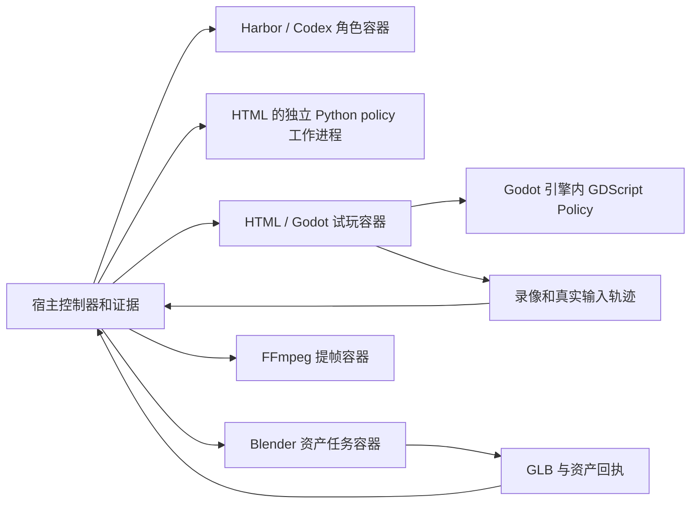

# HTML、Godot、Blender 容器运行环境

`runtime.mode: docker` 将 HTML/Godot 的构建、实际试玩、录像，以及 Blender 资产脚本和录像关键帧提取，放进同一套 Linux 镜像。主控制器、文件存储、Harbor 调度和混元 API 调用仍在宿主；四 Agent 的职责和阶段顺序不变。

## 共享什么、隔离什么

所有任务复用一个镜像。每次构建、每条试玩轨迹、每次 Blender 或媒体处理任务使用独立临时容器，完成后清理，产物保存到宿主目录。默认收集三条轨迹，逐条执行，不共享存档或桌面；可通过配置提高并行数。Godot 的 `.gd` Policy 在各自游戏进程内执行；HTML 的 Python Policy 另有独立工作进程。



游戏、Blender 和媒体任务使用 `rsi-gamecreator/runtime:full-v1`。角色镜像为 `game-agent-lite/codex:0.153.4-godot-v1`，预装匹配的 Godot、Python/Node Playwright 1.62.0、对应 Chromium 和 Pillow；HTML Policy 工作进程也可复用它。不向角色容器挂载 Docker socket。Codex 编写脚本，框架在相应阶段执行。Godot 策略执行器随框架只读挂载。

HTML 的 HTTP 服务与 Chromium 在同一个容器内，使用回环地址访问，不开放宿主端口。Godot 使用 `DISPLAY=:99` 的 Xvfb；HTML 默认 headless，配置 `headless: false` 时也仅在容器 Xvfb 中显示。均不连接宿主桌面、真实键鼠或 XQuartz。

## 镜像与安装

以普通用户在仓库根目录构建，不使用 sudo 运行控制器：

```bash
docker build -f docker/runtime.Dockerfile -t rsi-gamecreator/runtime:full-v1 docker
docker build -t game-agent-lite/codex:0.153.4-godot-v1 docker
```

统一镜像内含：

| 组件 | 配置 |
|---|---|
| Python | 3.12，控制器 worker 使用 |
| Godot | 4.7.2，官方发行包 SHA-512 校验 |
| Blender | Debian 13 的 4.3.2，含其 Python 所需 NumPy/Pillow；构建时实际导出 GLB 验证 |
| Playwright | 1.62.0，与仓库锁文件一致，安装匹配 Chromium 与浏览器系统依赖 |
| Node.js / npm | Node 22 镜像提供，用于 HTML 构建 |
| Xvfb / Mesa | 独立虚拟显示、CPU 软件渲染 |
| FFmpeg / ffprobe | 视频编码、媒体检查和关键帧提取 |
| 字体 | DejaVu、Noto CJK |

Blender 使用 Debian 的嵌入式 Python，与 worker 的 Python 3.12 不同；向 `/usr/local` Python 安装 NumPy 不能替代 Blender 的依赖。镜像不含 Codex 登录、混元密钥或生成模型。框架包在运行时只读挂载，系统依赖固定在镜像内。

macOS Docker Desktop / Linux arm64 是原有实测平台。Windows 使用 `runtime.cli: wslc` 和 [godot-wslc.json](../examples/godot-wslc.json)，并由此构建 Dockerfile 里的 amd64 分支。WSLC 3.0.3 不能表达 `--init`、`--read-only`、`--cap-drop` 和 `--security-opt`，所以容器根文件系统可写；只读挂载仍然生效。角色容器不经过 Harbor。基础镜像标签、系统库可能随上游变化，以回执中的镜像内容 ID 和工具版本识别环境，不保证跨日期重新构建逐字节一致。

## 新实验配置

使用 [html-docker.json](../examples/html-docker.json) 或 [godot-docker.json](../examples/godot-docker.json)。以下启动会实际调用模型，并按设计请求生成资产：

```bash
.venv/bin/game-agent start examples/html-docker.json \
  --prompt '制作一个完整的中文 HTML 卡牌游戏，按需生成并集成混元卡面。' \
  --run-dir runs/html-docker-first
```

配置片段：

```json
"runtime": {
  "mode": "docker",
  "image": "rsi-gamecreator/runtime:full-v1",
  "health_timeout_seconds": 30,
  "build_network": "none"
}
```

- 新容器示例默认不限轮数和资产预算；一轮验证请在独立 `.local.json` 设置 `rounds: 1`。不需要的资产能力显式设对应 `assets.max_*: 0`。
- 省略 `runtime` 仍为本地模式，兼容旧配置；容器镜像不存在会报错，不自动拉取或回退本机工具。
- 容器模式无需宿主 Godot、Blender、Chromium 或 FFmpeg。主控制器依赖、Harbor、Docker、登录与混元凭据仍按 README 准备。
- `godot`、`blender`、`ffmpeg` 的宿主可执行文件路径只用于本地执行；容器使用镜像内命令。

## 构建与网络

`build_command` / `check_command` 是参数数组，在 Linux 容器内执行，cwd 为 `/source`。HTML 构建可生成原先不存在的入口；最终入口必须存在。

需要 npm 等联网安装时，显式设置 `runtime.build_network: bridge`，在 `build_command` 指定的脚本中执行 `npm ci` 和构建。只有构建容器启用网络；试玩、Blender、媒体任务仍无外网。默认是 `none`。不会自动把任意 package.json 当作安装或运行指令。

构建产物应是可被静态 HTTP 服务加载的文件；把 JS、字体、图片等依赖打包到项目中。`node_modules` 不进入游戏快照，因此不能依赖试玩期间的 npm dev server 或 CDN。带后端服务的 Web 应用、额外联网服务和运行时下载不属于当前 HTML 适配器支持范围。

## Blender 与媒体任务

Designer 仍使用原有 `kind: blender` 请求，`source` 为草稿内脚本路径。Builder 写脚本，宿主资产阶段在容器里调用：

```text
blender --background --factory-startup --python-exit-code 1 \
  --python <脚本副本> -- --output /output/asset.glb
```

输入挂载只读，脚本在独立项目副本内执行，允许相对路径临时写入。请求可声明
`output_format: "glb"` 或 `"png"`；PNG 时上述输出路径改为 `/output/asset.png`，脚本需
设置 PNG 渲染并写入传入的 `--output`。只支持单张图，不增加动画或多产物协议。
无 GPU 时可用 CPU Cycles；部分架构的 Blender 没有 OpenImageDenoise，脚本设置
`scene.cycles.use_denoising = False`，避免渲染被默认降噪选项阻断。
旧请求缺省或 null 时仍为 GLB，原请求指纹与已完成资产回执保持兼容。

```json
{"id":"crate_sprite","kind":"blender","prompt":"","source":"assets/render_crate.py","output_format":"png"}
```

框架校验输出格式并沿用文件哈希与集成流程。资产目录保留 `blender-run-*/` 日志及
`job.json` 的环境身份。已完成资产按哈希复用；未完成资产若更换环境则拒绝静默重跑。
不新增同轮混元产物到 Blender 的自动后处理接口。

视频仍固定 **640×360、2 FPS**。HTML 使用 Playwright 录像后转码，Godot 定时采样后编码。每局结束保存录像后，独立媒体容器每 10 秒提取关键帧，保留视频时间戳。提帧失败后可恢复后处理，不重放已完成输入；本地模式仍使用宿主 FFmpeg。

## 文件、停止与恢复

- 构建允许写候选，检查后再固定版本。试玩挂载只读候选；HTML 与 Godot 均使用每局副本，浏览器存储、Godot 存档和导入缓存互不共享。
- 每个容器只有所需输入、独立输出和只读框架挂载；无宿主输入设备、凭据或 Docker socket。根文件系统只读，非 root 运行，使用私有临时目录和共享内存。
- `container-runtime.json` 记录镜像内容 ID、架构、框架哈希、任务用途、工具版本、网络模式和输入版本。HTML `runtime.json` 额外记录实际 Chromium 版本。
- Player 计划冻结镜像 ID 和框架哈希；同一会话的轨迹不能混用环境。更新框架或从旧 Godot-only 镜像切到 full 镜像时，应创建新实验或显式建立新试玩会话，不能只改旧配置后期待复用旧计划。
- `game-agent stop <run>` 会取消任务并清理本实验所有权匹配的容器；游戏尝试释放输入、保存已采样录像。`resume` 在实验锁内清理遗留任务，校验已完成证据，未完成局从新实例开始。
- 丢失回复的动作不自动重发，避免重复操作。30 秒是无心跳健康超时，长操作持续发心跳；不设置整个 rollout 时限。

## 不调用模型的验证

离线测试：

```bash
.venv/bin/pytest -ra
```

构建 full 镜像后，用真实引擎与固定脚本验证：

```bash
env GAME_AGENT_RUNTIME_IMAGE=rsi-gamecreator/runtime:full-v1 \
  .venv/bin/pytest tests/test_runtime_integration.py tests/test_runtime_full_integration.py -ra
```

覆盖 HTML/Godot 并行输入、存档隔离、录像、停止、恢复、Blender 导出并被 Godot 导入、Blender 异常与取消、容器 Node 构建。新增完整链路测试将宿主引擎路径设为不存在，验证不回退本机工具；既有视频格式测试的独立探针仍使用宿主 `ffprobe`。这些测试不调用模型或生成服务。运行命令见 [测试指南](testing.md)。

软件渲染不保证复杂 3D 性能；暂不提供 GPU、C#/.NET、额外原生扩展或联网游戏环境。引擎支持与固定夹具通过不等于任意生成游戏都可通关，也不证明游戏更好玩。
